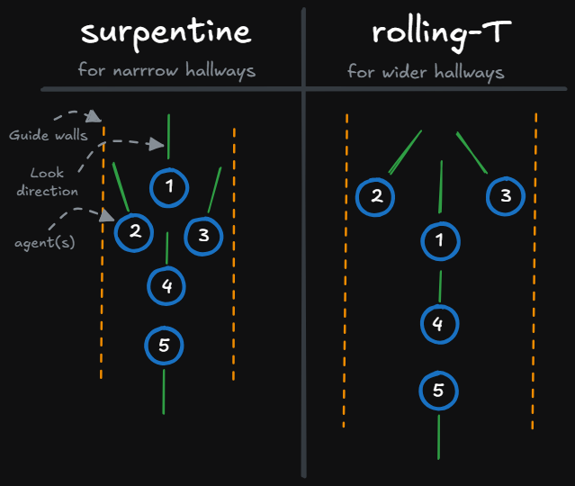
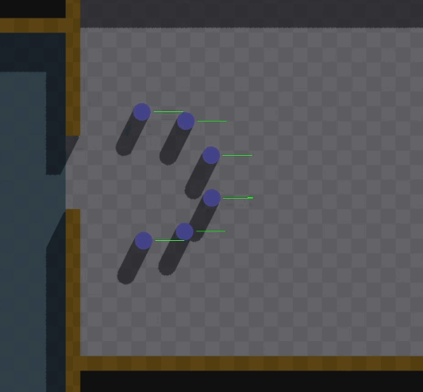
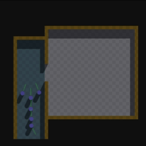
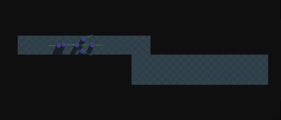
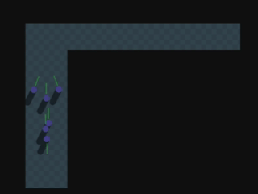
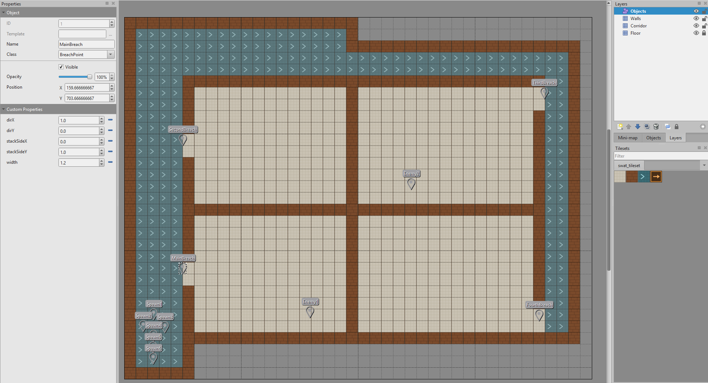



# Adaptive Squad Formations for Breach-and-Clear AI

I'm a 3rd year student and Breda University of Applied Sciences, my name is Tijn Flinterman and this blog post covers my journey through AI formations, What it is, how I made it and how I used it to make my SWAT-style breach-and-clear system in C++. 

**Table of contents**
- Stack Up: Why Formations?
- Squad leader to Rear Security: Roles and Slots
- Form Up: Formation Types
- On My Mark: The Squad State Machine
- Tight Quarters: Adaptive Corridor Movement
- Drawing the Floor Plan: Authoring Levels with Tiled
- Eyes On: Detection and the Human Element
- Briefing Room: Designer-Facing Tools
- After-Action Report: Common Problems and Solutions
- Debrief

--- 
<video controls width="100%">
  <source src="assets/videos/hero-breach-sequence.mp4" type="video/mp4">
</video>

## Stack Up: Why Formations?

Formations are structured tactical arrangements of groups. Formations offer a solution if you want an organized crowd layout that keeps its shape when navigating obstacles and other terrain instead of a group of independent pathfinders that just happen to walk in the same direction.

To tackle this topic I picked a SWAT breach-and-clear scenario to serve as an overarching contextual narrative to give the viewer/user a more intuitive view of what to expect and its application of it.
This approach also has the added benefit of its real life counterpart also making heavy use of formations when doing its breach-and-clear. From performing a Rolling-T technique narrow and wide to stacking up next to a breach point and then spreading out to the room.

## Squad Leader to Rear Security: Roles and Slots

A formation is a list of "slots", slots are relative to the formation in position and orientation instead of being in world space.

```cpp
struct FormationSlot
{
    glm::vec2 localOffset;
    int priority;
    float facingOffsetDegrees = 0.0f;
};
```
"priority" sets breach order
"facingOffsetDegrees" lets an agent watch a different direction than the group as a whole is heading.

Converting a slot into a world position is a rotation and a translation — rotate the local offset by the formation's current facing angle, add it to the center:

```cpp
glm::vec2 Formation::GetSlotWorldPosition(int slotIndex, const glm::vec2& center, const glm::vec2& facing) const
{
    const FormationSlot& slot = m_slots[slotIndex];
    float angle = std::atan2(facing.y, facing.x);
    glm::vec2 rotated = geometry2d::RotateCounterClockwise(slot.localOffset, angle);
    return center + rotated;
}
```

That's pretty much all the math for relative position. "facingOffsetDegrees" gets resolved the same way, except you add it to the formation's heading angle instead of rotating an offset. The transform stays this simple no matter how complex the formation gets. The interesting part is which shapes you define and when you switch between them.

## Form Up: Formation Types

At the end of development I had a few distinct shapes, each used in a different context of the breach sequence. Both corridor formations come from the US Army's urban-combat manual, FM 90-10-1 (thats why I spell it as "surpentine").

**Surpentine** and **Rolling-T** are the two corridor-movement formations, and the ones I spent the most time on.

- **Surpentine** is used in narrow corridors: the squad leader anchors the front-center, with two agents close behind him, left and right, looking outward. The rest of the squad follows in a column, ending with a rear guard facing backward.

- **Rolling-T** is used in wide corridors: Two agents move forward and ahead of the squad leader, left and right (the top bar of the "T"), and each covers the *opposite* side of the hallway from the one they are walking on. A squad leader stands behind them (the stem of the "T") and covers the far end of the hallway, looking between the pair. The manual's fourth man provides rear security. My squads are bigger than the manual's four-man team, so the remaining agents trail in a column and the last one acts as the rear guard, facing backward.

--- 


Instead of hard-coding the shape in C++, you can create formations based on squad size with 2 settings for narrow and wide with position and offsets using a small editor. This exports the data into JSON which is later used during runtime.

```cpp
const auto& editorSlots = m_formationEditor->GetFormation(squadSize, variant);
if (!editorSlots.empty())
{
    std::vector<glm::vec2> localOffsets;
    std::vector<float> localRotations;
    for (const auto& es : editorSlots)
    {
        localOffsets.push_back(glm::vec2(-es.offset.y, -es.offset.x));
        localRotations.push_back(-es.rotationDegrees);
    }
    *m_currentFormation = Formation::CreateFromLocalOffsets(localOffsets, localRotations, FormationType::Corridor);
    AssignFormationSlots();
    return;
}
```

Keeping the exact spacing and angles out of C++ was a something I purposely spend time on to give clearer context of relative positions and rotations (which is important for formations). This made it a lot more intuitive instead of having to make a huge list of magical numbers which are hard to tweak and imagine.

**Wall Stack** lines agents up against the wall besides the breach point. The direction that it stacks on is set in level data. This formation is taken when the squad is close enough to a breach point where they prepare to breach.

**Room Clear Spread** fans agents across an arc once they're through a door, covering the room:

```cpp
Formation Formation::CreateRoomClear(int numAgents, float radius)
{
    Formation formation(FormationType::RoomClearSpread);
    if (numAgents == 1)
    {
        formation.m_slots.push_back({{0.0f, 0.0f}, 0});
        return formation;
    }

    float angleStep = glm::pi<float>() / (numAgents - 1);
    float startAngle = -glm::half_pi<float>();

    for (int i = 0; i < numAgents; ++i)
    {
        float angle = startAngle + i * angleStep;

        FormationSlot slot;
        slot.localOffset = glm::vec2(std::cos(angle) * radius, std::sin(angle) * radius);
        slot.priority = i;
        formation.m_slots.push_back(slot);
    }

    return formation;
}
```
--- 


*The four formation shapes, top-down: Surpentine and Rolling-T, Room Clear Spread, Wall Stack.*

## On My Mark: The Squad State Machine

The whole breach sequence is one state machine per squad:

```cpp
void FormationSquad::Update(const Navmesh& navmesh, float dt)
{
    switch (m_state)
    {
        case SquadState::MovingToBreachPoint: UpdateMovingToBreach(navmesh, dt); break;
        case SquadState::FormingUp:           UpdateFormingUp(navmesh, dt);      break;
        case SquadState::SlicingThePie:       UpdateSlicingThePie(navmesh, dt);  break;
        case SquadState::Breaching:           UpdateBreaching(navmesh, dt);      break;
        case SquadState::RoomClearing:        UpdateRoomClearing(navmesh, dt);   break;
    }
    // ...each agent recomputes its path and velocity toward its current slot goal
}
```

The squad travels to a breach point using surpentine or rolling-T dependant on the corridor width, forms up in a Wall Stack beside the door to keep clear from enemies within the room, and waits for the breach command. On that command, the squad leader slices the pie sweeping the room to get as much vision of the room before going in.

The code for "Slicing the pie":

```cpp
glm::vec2 radialDir = geometry2d::RotateCounterClockwise(m_formationFacing, rad);
glm::vec2 rawArcPos = m_slicePivot - radialDir * m_sliceRadius;
glm::vec2 resolvedArcPos = navmesh.FindClosestReachablePoint(squadLeaderBody->GetPosition(), rawArcPos);
```

After slicing the pie, the squad breaches. One at a time the agents flood the room, creating a semicircle arc to clear the room for enemies. If the room is clear or the enemies are arrested the agents move to the next breach point, waiting for the next command.

--- 


*Forming up, slicing the pie, then entry through the breachpoint.*

## Tight Quarters: Adaptive Corridor Movement

To make the squad be able to switch between surpentine and rolling-T on the fly I needed a way to detect the width of a corridor to decide which formation it should take. So when the squad is in inside a corridor, it measures the width of said corridor and based on a setting value it will switch formations based on an adjustable width :

```cpp
void FormationSquad::UpdateFormationShapeForTerrain()
{
    bool inCorridor = IsInCorridor(m_formationCenter);
    FormationEditor::Variant variant = FormationEditor::Wide;
    if (inCorridor)
    {
        float width = MeasureCorridorWidth(m_formationCenter);
        variant = (width < m_narrowWidthThreshold) ? FormationEditor::Narrow : FormationEditor::Wide;
    }

    if (m_currentFormation->GetType() == desired && variant == m_currentRollingTVariant) return;

    m_currentRollingTVariant = variant;

    // ...rebuild the formation slot data for this variant
}
```

The same idea is used for centering the formation when they navigate through corridors, it finds the centerline by measuring the distance between left and right and setting the overall formation target along that path :

```cpp
glm::vec2 FormationSquad::SnapToCorridorCenterline(const glm::vec2& pos) const
{
    for (const auto& region : m_corridorRegions)
    {
        if (!geometry2d::IsPointInsidePolygon(pos, region)) continue;

        RegionBounds b = ComputeBounds(region);
        glm::vec2 result = pos;
        if (b.Width() < b.Height())
            result.x = (b.minX + b.maxX) * 0.5f;
        else
            result.y = (b.minY + b.maxY) * 0.5f;
        return result;
    }
    return pos;
}
```

--- 


*The squad reshaping from surpentine to rolling-T as the corridor widens, with corridor center snapping.*


When pathfinding, the "path" it gives back only gives me a few points, and the lines between them can drift toward a wall. So I add more points along the path and snap each one to the middle of the corridor :

```cpp
std::vector<glm::vec2> FormationSquad::ResampleAndSnapPath(const std::vector<glm::vec2>& rawPath) const
{
    if (rawPath.size() < 2) return rawPath;

    std::vector<glm::vec2> result;
    result.push_back(SnapToCorridorCenterline(rawPath.front()));

    for (size_t i = 0; i + 1 < rawPath.size(); ++i)
    {
        glm::vec2 a = rawPath[i];
        glm::vec2 b = rawPath[i + 1];
        float segLen = glm::distance(a, b);
        int steps = std::max(1, static_cast<int>(segLen / m_centerlineResampleSpacing));

        for (int s = 1; s <= steps; ++s)
        {
            float t = static_cast<float>(s) / steps;
            result.push_back(SnapToCorridorCenterline(glm::mix(a, b, t)));
        }
    }
    return result;
}
```

The first version took only one direction across the hallway for centering. This was good enough for the early stages of development when all my hallways were vertical, but it was useless when moving to a horizontal one.
The squad had to find out which direction would be considered "across the hallway" so it now checks the segment "shape" itself.

--- 


*Center snapping working horizontally and vertically.*

## Drawing the Floor Plan: Authoring Levels with Tiled

Levels are built in [Tiled](https://www.mapeditor.org/) instead of a custom in-engine editor I started with and later abandoned. I felt like using this was a lot better for the time investment since I would have been just making a worse version of tiled. The level is spread out in ("Floor", "Corridor", "Walls") to differentiate walkable and non-walkable. 

A point-object layer is used for breach points (entry direction, stack side, visit order) and spawn locations for enemies and agents, breach points read out as plain custom properties:

```cpp
TiledBreachPoint bp;
bp.position = worldPos;
bp.direction = glm::normalize(glm::vec2(
    props.count("dirX") ? props["dirX"] : 1.0f,
    props.count("dirY") ? -props["dirY"] : 0.0f));
bp.order = props.count("order") ? static_cast<int>(props["order"]) : static_cast<int>(result.breachPoints.size());
```

Agents and enemies are simply just stored as 2D vectors :

```cpp
std::vector<glm::vec2> agentSpawns;
std::vector<glm::vec2> enemySpawns;
```

One improvement I made was merging loose tiles into rectangles for better navmesh generation. My first version created one polygon per filled tile and relied on the navmesh generator's polygon-union step to stitch them back into a single walkable region. But when the map expanded to be thousands of tiles big, for a higher resolution map, this became an issue.

To resolve the problem I replaced this with a greedy merge: grow each region right as far as it can, then down as far as the full width stays filled, repeat until every filled cell belongs to some rectangle.

```cpp
for (int row = 0; row < mapHeight; ++row)
{
    for (int col = 0; col < mapWidth; ++col)
    {
        if (!grid[row][col] || visited[row][col]) continue;

        int width = 1;
        while (col + width < mapWidth && grid[row][col + width] && !visited[row][col + width]) ++width;

        int height = 1;
        bool canExtend = true;
        while (canExtend && row + height < mapHeight)
        {
            for (int c = col; c < col + width; ++c)
            {
                if (!grid[row + height][c] || visited[row + height][c])
                {
                    canExtend = false;
                    break;
                }
            }
            if (canExtend) ++height;
        }

        for (int r = row; r < row + height; ++r)
        {
            for (int c = col; c < col + width; ++c) 
            {
                visited[r][c] = true;
            }
        }
            
        result.push_back(MakeRectPolygon(col, row, width, height, mapWidth, mapHeight, unitsPerTile));
    }
}
```

Improvement numbers:
- Floor layer from 15,674 tiles to 10 rectangles
- Walls layer from 1,492 tiles to 21 rectangles
- Corridor layer from 9,454 tiles to 4 rectangles

--- 

*The level authored in Tiled: Floor, Corridor, and Walls layers, with a BreachPoint object's custom properties visible.*

## Eyes On: Detection and the Human Element

Formation movement alone doesn't make a breach feel tactical — it needs something to react to.

**Vision cones.** Each agent carries a `VisionCone` (range, field of view, current target); every frame it checks nearby detectable entities for angle and range, then fires a *single* raycast to confirm line of sight, rather than sweeping many rays to approximate the same check:

```cpp
float angle = glm::acos(glm::clamp(glm::dot(cone.facing, dirToTarget), -1.f, 1.f));
if (angle > halfFovRad) continue; // outside the FOV wedge

const auto& hit = physicsSystem.RaycastGetNearest(rayStart, dirToTarget);
bool blocked = hit.has_value() && hit->m_hitEntity != targetEntity
               && hit->m_rayDistance < (dist - startOffset - 0.1f);
if (blocked) continue;

cone.hasTarget = true;
cone.facing = dirToTarget; // turn to actually look at what was spotted
```

`rayStart` is offset outward from the agent's own position by its collider radius before the raycast is even fired — starting the ray exactly at an agent's own center meant it would immediately hit its own collider at `t = radius`, before ever reaching a real target, silently failing every detection check. More on that below.

**Fog of war.** Rather than tracking visibility per enemy, I track it over a grid of fixed-size cells laid out across the walkable regions, each marked `everSeen` once any agent's vision cone confirms it:

```cpp
for (auto [viewerEntity, cone, viewerBody] : ecs.Registry.view<VisionCone, physics::Body>().each())
{
    glm::ivec2 centerCoord = WorldToCellCoord(viewerBody.GetPosition());
    int cellRadius = static_cast<int>(std::ceil(cone.range / m_cellSize)) + 1;

    for (int dy = -cellRadius; dy <= cellRadius; ++dy)
    for (int dx = -cellRadius; dx <= cellRadius; ++dx)
    {
        // ...angle + range check against the cell center, same shape as the vision cone check above

        const vec2 rayStart = eyePos + dir * startOffset; // same self-intersection fix as vision cones
        auto hit = physicsSystem.RaycastGetNearest(rayStart, dir);
        if (hit.has_value() && hit->m_rayDistance < (dist - startOffset - 0.1f)) continue;

        cell.everSeen = true;
    }
}
```

Having already hit the self-intersecting raycast bug once with vision cones, fog of war reuses the exact same radius-offset fix from the start rather than rediscovering it. The unseen-area mesh only gets rebuilt on frames where at least one cell actually changed state (`anyCellChangedState`), rather than every frame regardless — a small but free optimization, since most frames nothing new is revealed.

<!-- PLACEHOLDER: gif showing the squad advancing with vision cones debug-drawn, fog of war peeling back as they move, and a cone flashing red on spotting an enemy -->

*Vision cones sweeping as fog of war clears, with a cone turning red the moment it spots an enemy.*

**Arrests and roles.** Once spotted, the squad can peel a teammate off to arrest an enemy, removing that agent from the active roster for the rest of the room:

```cpp
entt::entity arrestingAgent = m_swatSquad->GetAgents().back();
if (m_swatSquad->RemoveAgent(arrestingAgent))
{
    ecs.Registry.emplace<ArrestingAgent>(arrestingAgent, nearestEnemy);
    // ...send them toward the enemy's position
}
```

Roles (Point Man, Breacher, Support, Rear Guard) aren't stored per agent — they're read off current slot index relative to squad size:

```cpp
static const char* SlotToRoleName(int slotIndex, int squadSize)
{
    if (slotIndex == 0) return "Point Man";
    if (slotIndex == 1) return "Breacher";
    if (slotIndex == squadSize - 1) return "Rear Guard";
    return "Support";
}
```

Which means an arrest, which shrinks the roster and re-indexes everyone, gets correct role promotion for free. If the agent in slot 1 (Breacher) is pulled off to make an arrest, the remaining agents are reindexed from 0, and whoever was slot 2 becomes the new slot 1 — picking up the Breacher label automatically, with no explicit "who's next" logic anywhere.

## Briefing Room: Designer-Facing Tools

A live ImGui panel exposes squad speed, breach timing, corridor thresholds, and slice angle/duration as sliders that apply instantly, alongside buttons for every squad command and toggles for each debug layer.

<!-- PLACEHOLDER: screenshot of the actual ImGui panel - squad state, formation type, the Squad Settings sliders, and the command buttons all visible in one shot -->

*The live tuning panel: squad state, current formation, every tunable slider, and squad commands.*

A checkpoint system snapshots the full roster, positions, and formation the moment the squad reaches `ReadyToBreach`:

```cpp
void FormationSquad::SaveReadyToBreachCheckpoint()
{
    m_readyCheckpoint.agents = m_agents; // the full roster, not just positions
    for (entt::entity agentEntity : m_agents)
    {
        auto* body = Engine.ECS().Registry.try_get<physics::Body>(agentEntity);
        m_readyCheckpoint.agentPositions.push_back(body ? body->GetPosition() : glm::vec2(0, 0));
    }
    m_readyCheckpoint.formation = std::make_unique<Formation>(*m_currentFormation);
    m_readyCheckpoint.breachPointIndex = m_currentBreachPointIndex;
    m_hasCheckpoint = true;
}
```

This is what lets one button rewind *just the current room's attempt*. Deciding what "rewind" should actually mean once an arrest has happened took a moment of real thought: it could restore only positions and leave the roster permanently smaller (treating an arrest as irreversible attrition even on retry), it could refuse to restore at all once an arrest has happened (flagging the checkpoint stale), or it could fully undo the arrest — bringing the agent back and reverting the enemy's cuffed state — so a retry is a genuine clean slate. I went with the third option, since "retry this room" reads to a player as "as if that attempt never happened," which an arrest is very much part of. The detail that makes it possible is storing the full agent list in the checkpoint rather than only positions — a checkpoint that only remembered positions would restore the wrong roster size the instant an arrest had happened since it was saved.

## After-Action Report: Common Problems and Solutions

**Agents piling up at the doorway.** My first breach sequence sent every releasing agent toward the same single point a short distance through the door, meaning to let them spread out once inside. In practice this meant agents converging on one coordinate and jamming against each other in the doorway — whoever was released last had to shove through a growing crowd, and in a narrow door simply couldn't. Fixed by computing the full Room Clear Spread *before* releasing anyone, so each agent could be sent directly to its own final slot as it's released.

**A vision cone that could never see anything.** The very first version of the detection raycast started exactly at the viewing agent's own position. A ray starting at the center of a circle immediately re-intersects that same circle's boundary at `t = radius` — so the raycast would report a "blocking" hit (its own collider) before ever reaching a real target, for virtually every detection check regardless of distance. Offsetting the ray's starting point outward by the agent's own collider radius first fixed it — and the same fix got reused directly when fog of war needed the same kind of raycast later.

**A navmesh that looked fine but wasn't.** One polygon per tile, relying on a union step to stitch them together, occasionally left visible splits even in correctly-painted rooms. Merging same-type tiles into rectangles up front fixed it, and incidentally made navmesh generation faster besides.

**A squad that could softlock on an unreachable position.** The Room Clear Spread's outer slots sit near the full radius at a steep angle; in a tighter room than tuned for, that position can land outside the walkable navmesh, and that one agent's pathfinding silently fails. Since the squad only advances once every agent reports being in position, this could hang the whole mission on one agent that would never arrive. A timeout — proceed anyway after a few seconds, with a logged warning — turned a hard failure into a graceful one.

**Two divergent copies of "spawn a squad."** Once restart existed, I had one spawn function from startup and a second, separately-written one for restarts, and they drifted apart in agent speed and vision parameters. A restart would silently create a second full set of agents on top of the still-alive originals; the overlapping colliders got violently flung apart by collision resolution the instant physics ran, which looked exactly like agents vanishing a frame after spawning. Fixed by making exactly one function define what spawning a squad means, called identically from startup and every restart path.

## Debrief

Formations turn out to be mostly discipline in a coordinate transform — local offsets, a shared center and facing, and judgment about when to swap which shape is active — rather than anything mathematically deep. The real work was everywhere around that core: making the group's movement respect the terrain, giving it something to react to, keeping squad-composition changes like an arrest coherent with role assignment and checkpointing instead of fighting them, and making the whole thing legible enough that someone other than me could sit down and immediately understand what it was doing.

If I keep building on this, the natural next steps are coordinated multi-squad tactics and giving detected threats somewhere to actually retreat to. But as a first dive into formations, this covered the ground I set out to cover.

## Resources

A few resources that helped shape the tactical side of this project:

- [Squad-Based Coordination in the AI of F.E.A.R.](https://www.gdcvault.com/play/1022016/Squad-Based-Coordination-in-The) — GDC talk on coordinated squad AI, directly relevant to how roles and coordination are handled here.
- [Close-quarters battle (Wikipedia)](https://en.wikipedia.org/wiki/Close-quarters_battle) — general background on the real-world tactics (stacking, slicing the pie, staggered entry) this system is modeled after.
- [TC 90-1, Training for Urban Operations](https://armypubs.army.mil/epubs/DR_pubs/DR_a/pdf/web/tc90_1.pdf) — US Army training circular on urban operations training, used as reference for breach and room-clearing procedure.
- [FM 90-10-1, An Infantryman's Guide to Combat in Built-Up Areas](http://pdf.textfiles.com/manuals/MILITARY/united_states_army_fm_90-10x1%20-%2012_may_1993%20-%20part09.pdf) (pages 6, 10–18) — US Army field manual covering room-clearing fundamentals.


